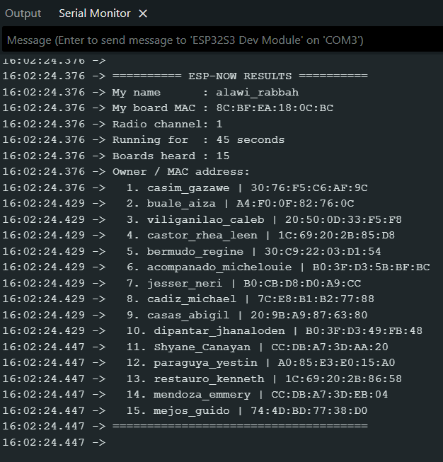

# alawi_rabbah

- **Name:** alawi_rabbah
- **My board's MAC address:** 8C:BF:EA:18:0C:BC
- **Number of boards heard:** 15
- **MAC addresses heard:**
  1. 30:76:F5:C6:AF:9C
  2. A4:F0:0F:82:76:0C
  3. 20:50:0D:33:F5:F8
  4. 1C:69:20:2B:85:D8
  5. 30:C9:22:03:D1:54
  6. B0:3F:D3:5B:BF:BC
  7. B0:CB:D8:D0:A9:CC
  8. 7C:E8:B1:B2:77:88
  9. 20:9B:A9:87:63:80
  10. B0:3F:D3:49:FB:48
  11. CC:DB:A7:3D:AA:20
  12. A0:85:E3:E0:15:A0
  13. 1C:69:20:2B:86:58
  14. CC:DB:A7:3D:EB:04
  15. 74:4D:BD:77:38:D0
- **Date and time of window:** November 11, 2026, 2:00 PM to 3:00 PM

## Owners of the boards heard

| # | Owner | MAC address |
|---|-------|-------------|
| 1 | casim_gazawe | 30:76:F5:C6:AF:9C |
| 2 | buale_aiza | A4:F0:0F:82:76:0C |
| 3 | viliganilao_caleb | 20:50:0D:33:F5:F8 |
| 4 | castor_rhea_leen | 1C:69:20:2B:85:D8 |
| 5 | bermudo_regine | 30:C9:22:03:D1:54 |
| 6 | acompanado_michelouie | B0:3F:D3:5B:BF:BC |
| 7 | jesser_neri | B0:CB:D8:D0:A9:CC |
| 8 | cadiz_michael | 7C:E8:B1:B2:77:88 |
| 9 | casas_abigil | 20:9B:A9:87:63:80 |
| 10 | dipantar_jhanaloden | B0:3F:D3:49:FB:48 |
| 11 | Shyane_Canayan | CC:DB:A7:3D:AA:20 |
| 12 | paraguya_yestin | A0:85:E3:E0:15:A0 |
| 13 | restauro_kenneth | 1C:69:20:2B:86:58 |
| 14 | mendoza_emmery | CC:DB:A7:3D:EB:04 |
| 15 | mejos_guido | 74:4D:BD:77:38:D0 |

## Evidence

[Serial Monitor video](alawi_serialmonitor.mp4)
